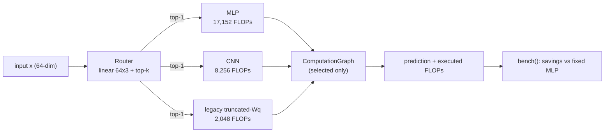
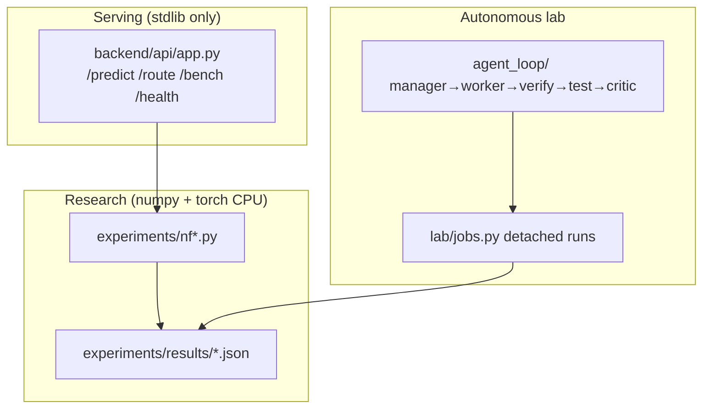

# NEURAL FABRIC

### *Route less. Compute less. Prove it.*

A research system that tests whether **input-conditioned composition of heterogeneous computational primitives** beats fixed architectures under comparable budgets — with corrected FLOP accounting, 10-seed statistics, preserved negative results, and a live demo you can run in a minute.

[](docs/REPRODUCIBILITY.md) [](tests/) [](docs/RESULTS.md) [](docs/PROJECT_COMPLETE.md)

**The historical experiments compare router-selection accuracy and estimated computation, with measurable route specialization and reported negative results.**

**Interpretation:** The historical NF-02 and NF-12 accuracy figures measure how accurately the router selects the synthetic input's assigned mode. They do not measure predictions produced by the selected primitives. The serving demo uses untrained weights, so its outputs are not evidence of trained end-to-end classification accuracy. FLOP figures are analytical estimates, not measured latency.

**Looking for the trainable classifier?** The [usable-system feature branch](https://github.com/PrathamKapoor/Neural-Fabric/tree/feature/usable-neural-fabric) contains the trained model, numeric CSV workflow, local API, screenshots, and cross-platform checks. It has not yet been merged into `main`.

---

## Why Neural Fabric?

Most efficiency work compares against weak or mismatched baselines:

```
Typical claim:    Our dynamic model  →  fewer FLOPs  →  (vs nobody in particular)
Neural Fabric:    Router             →  top-1 execution  →  vs matched fixed MLP/CNN/projection,
                                                     same data, splits, seeds, budget, cost model
```

The question was asked *before* the results, the cost model was corrected mid-program (CNN was undercounted ~7×, the "attention" primitive overcounted ~6×), and every null/negative finding is kept in the record — including a genuine-softmax-attention control that loses 10/10 under the fixed budget.

---

## The Research Loop

```
  QUESTION  ──────►  BASELINES  ──────►  ROUTE  ──────►  TRADEOFF
     ▲                                                        │
     │                                                        ▼
   LIMITS   ◄──────  CONTROL  ◄──────  SPECIALIZE  ◄──  NULL RESULTS
```

1. **Question:** can heterogeneous conditional composition win under matched budgets?
2. **Baselines:** fixed MLP / CNN / legacy truncated-Wq projection, identical protocol.
3. **Route:** soft training + top-k conditional execution (unselected primitives bypassed).
4. **Tradeoff:** compute-aware λ sweep — strong penalty saves −752 FLOPs for −4.8pp (10 seeds, paired).
5. **Nulls kept:** comparative accuracy null (p≈0.37), shift failure (0.45→0.0), fresh-seed null (p=0.054).
6. **Control:** genuine QKV softmax attention vs legacy projection — loses 10/10, mean −27pp.
7. **Limits:** synthetic-only, n=10, uncorrected contrasts — stated in the docs, not the footnotes.

---

## Live Demo (real engine, real numbers)

```bash
.venv\Scripts\python.exe scripts\demo_routing.py
```

```
NEURAL FABRIC 60-SECOND DEMO (live engine, top-1 routing)
mode=spatial    route=[0.335, 0.416, 0.250] selected=['cnn'] flops=8256  vs mlp=17152 savings=51.9%
mode=relational route=[0.382, 0.395, 0.224] selected=['cnn'] flops=8256  vs mlp=17152 savings=51.9%
mode=dense      route=[0.411, 0.373, 0.216] selected=['mlp'] flops=17152 vs mlp=17152 savings=0.0%
```

Each line is a live `FabricEngine.predict` + `bench` call: router probabilities, selected primitive, executed FLOPs, measured savings vs the fixed-MLP baseline. The demo uses an untrained router — the *measured* accuracy/FLOP tradeoffs live in `experiments/results/` (pointers printed by the script). A styled visual demo page ships at `frontend/index.html` (run the backend below, then open it).

---

## System Architecture





Convention: 1 FLOP = 1 mul/add; bias + CNN pooling counted; ReLU/router-softmax excluded (`fabric/primitives/cost_model.py`). "Attention" below is the legacy truncated-Wq projection unless "genuine" is stated.

---

## Core Capabilities

### Heterogeneous Routing
- **Three real primitives** (MLP 8,707 params · CNN · truncated-Wq projection), not three copies of one layer.
- **Top-k conditional execution** with verified primitive bypass; soft, hard, and Gumbel-hard modes.
- **Compute-aware training** (NLL + entropy + λ·FLOPs objective).

### Measured Interpretability
- Route specialization: P(correct primitive | input mode) = 0.93, MI = 0.87 nats (max 1.10).
- Location-bound: flat router collapses on moved signals (0.56, p=0.003) — specialization does not transfer.

### Falsification-First Evidence
- Comparative null, shift failure, genuine-attention negative, and hollow-transfer results all shipped in `docs/RESULTS.md`.
- 10-seed paired statistics with CIs, sign counts, and explicitly **uncorrected** p-values.

### Deployable Serving
- Stdlib-only HTTP API (`/predict`, `/route`, `/bench`, `/health`), `NF_HOST`/`NF_PORT` config, graceful shutdown — live-tested in `tests/test_serve.py`.
- Hardened Docker context (`.dockerignore` excludes secrets/venvs/scratch); dynamic build untested here — stated, not claimed.

---

## Tech Stack

| Layer | Technology | Purpose |
|---|---|---|
| **Engine** | Pure Python (stdlib only) | Router, primitives, graph, cost model, serving |
| **Research numerics** | numpy 2.4.6, torch 2.14.0+cpu | Training variants, evaluation, tests |
| **Serving** | `http.server`, no framework | Zero-dependency API (`backend/api/app.py`) |
| **Lab** | `agent_loop/` + `lab/jobs.py` | Manager→worker→verify→test→critic loop, detached jobs |
| **Tests** | pytest / unittest, 342 tests | Unit, cost-model, provenance, security, serving, jobs |

---

## Quickstart (3 minutes)

### Prerequisites
- **Python:** 3.11.x
- **pip** (torch CPU only; no GPU code paths are validated)

### 1. Clone & install
```bash
git clone https://github.com/PrathamKapoor/Neural-Fabric.git
cd Neural-Fabric
pip install -r requirements.txt  # torch CPU: see header comment in requirements.txt
```

### 2. Run the 60-second demo
```bash
python scripts/demo_routing.py
```

### 3. Run the key experiment + inspect
```bash
python experiments/nf12_routing_modes.py   # seconds; writes experiments/results/nf12_routing_modes.json
python scripts/demo_routing.py
```

### 4. Run the full suite
```bash
python -m pytest tests/ -q   # 342 tests
```

### 5. Serve the API + open the visual demo
```bash
python backend/api/app.py   # :8080  (GET /health; NF_HOST/NF_PORT configurable)
# open frontend/index.html in a browser
```

> Rerunning an experiment overwrites its JSON in `experiments/results/` (values are deterministic; only timestamp/elapsed change). Back up the directory first if you need the committed artifacts byte-intact.

---

## 60-Second Judge Flow
1. **Run** `scripts/demo_routing.py` — routing decisions, FLOPs, savings, live.
2. **Read** the corrected headline: MLP 0.954 @ 17,152 vs top-1 0.942 @ ~8,805 (48.7% less compute on means, −1.2pp — descriptive, `docs/RESULTS.md`).
3. **Check** the tradeoff: NF-07 strong penalty −752 FLOPs (95% CI [−1084,−420], p≈0.0006 uncorrected) for −4.8pp.
4. **Confront** the negatives: accuracy null, shift 0.45→0.0, genuine attention −27pp.
5. **Reproduce**: `pytest tests/`, rerun any `experiments/nf*.py`, compare artifact JSONs.

---

## Verification & Testing
- **342 tests**: fabric units, v2 cost model, NF-01/NF-07/NF-12/NF-13/NF-14 validation, robustness, provenance, Docker/static security, serving (live HTTP), demo structure, lab jobs, 24h-session logic.
- Every behavior added ships with a test; no test was weakened or deleted to stay green.

## Documentation
- [Results & statistical caveats](docs/RESULTS.md) · [Experiments](docs/EXPERIMENTS.md) · [Research registry](docs/RESEARCH.md) · [Reproducibility](docs/REPRODUCIBILITY.md) · [Architecture](docs/ARCHITECTURE.md) · [Evidence ledger](docs/PROJECT_COMPLETE.md) · [Prior art & novelty](docs/research/)

